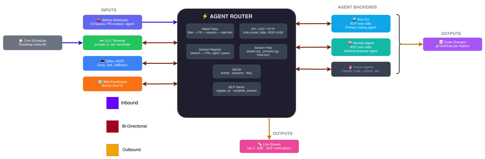

# Agent Router

A daemon that bridges GitHub events to AI coding agents.

When a check fails, when someone leaves a review comment, when CI returns red — Agent Router catches the webhook, decides whether it's worth waking an agent, and routes it to a persistent agent session bound to that PR. The agent fixes things, pushes commits, and merges when CI is green. You watch from a terminal, or check on it from your phone.

It's TypeScript, single-user, runs on your own machine behind a Cloudflare tunnel. MVP today; will be rewritten in Rust once the architecture is validated.

## What it does for you

**Catches GitHub events you'd otherwise have to triage.** Failed CI, review comments, `/agent` commands in PR threads. Each event flows through a wake policy that decides whether it's actionable and whether the author is trusted enough to direct an agent.

**Maintains persistent agent sessions per PR.** When a session is bound to a PR, every event for that PR routes back to the same conversation. Context accumulates. The agent remembers what it's been working on across days of intermittent feedback.

**Trust-tiered wake policy out of the box.** Repository owners and CI bots wake the agent on any event. Collaborators wake the agent only when they prefix a comment with `/agent`. Untrusted commenters never wake the agent. No allowlist to maintain — trust comes from `comment.author_association` on every webhook payload.

**Observable everything.** Every session writes append-only NDJSON to `~/.agent-router/sessions/<id>/stream.log`. Plain `tail -f` works. Multiple terminals can watch the same session. No special client, no auth, no API.

**Agent-agnostic.** Drives Kiro CLI today via the Agent Client Protocol over stdio. Anything that speaks ACP can be swapped in.



## Quick start

You need: Node.js 20+, git, a GitHub repo you control, a personal access token, and Kiro CLI installed somewhere.

```bash
# 1. Install
git clone https://github.com/gspivey/agent-router && cd agent-router
npm install

# 2. Configure
cp config.example.json config.json
# Edit config.json — set kiroPath and your repos

export GITHUB_WEBHOOK_SECRET="your-secret-here"

# 3. Set up the cloudflared tunnel
./scripts/setup-tunnel.sh
# In another terminal:
cloudflared tunnel run agent-router

# 4. Add the webhook on your GitHub repo
# Settings → Webhooks → Add webhook
#   Payload URL: https://<tunnel-id>.cfargotunnel.com/webhook
#   Content type: application/json
#   Secret: same value as GITHUB_WEBHOOK_SECRET
#   Events: Check runs, Issue comments, Pull request review comments

# 5. (Optional) Install a GLOBAL MCP config for Kiro.
#     As of the mcp-server-wiring feature the daemon wires its MCP server into
#     every session automatically — you do NOT need this for daemon-driven
#     sessions. Run it only for standalone/manual Kiro use outside the daemon.
#     If a global entry is present, the daemon warns at startup; remove it to
#     avoid duplicate tool registration.
# ./scripts/install-mcp-config.sh

# 6. Run it
npm run dev
```

You're now listening for webhooks. Test it:

```bash
echo "Look at PR #1 and fix the failing CI check" | agent-router prompt --new
```

Or fire one quietly and tail it:

```bash
SESSION_ID=$(echo "Fix CI" | agent-router prompt --new --quiet)
agent-router tail "$SESSION_ID"
```

## Configuration reference

All values can be hardcoded or read from environment variables using `"ENV:VAR_NAME"` syntax. Copy `config.example.json` as a starting point.

```jsonc
{
  // Required — port for the incoming GitHub webhook server
  "port": 3000,

  // Required — global HMAC-SHA256 secret for verifying webhook payloads.
  // Used as the fallback for any repo that doesn't have its own webhookSecret.
  "webhookSecret": "ENV:GITHUB_WEBHOOK_SECRET",

  // Required — absolute path to the Kiro CLI executable
  "kiroPath": "/path/to/kiro",

  // Optional — default GitHub PAT used for any repo without its own token.
  "defaultGithubToken": "ENV:GITHUB_TOKEN",

  // Optional — rate limiting between wakes for the same PR (default: 60s)
  "rateLimit": {
    "perPRSeconds": 60
  },

  // Optional — session lifetime controls (all have defaults shown below)
  "sessionTimeout": {
    "inactivityMinutes": 5,       // kill session if silent for this long
    "maxLifetimeMinutes": 120,    // hard cap regardless of activity
    "gracePeriodAfterMergeSeconds": 60  // extra time after a merge
  },

  // Required — list of repos to monitor
  "repos": [
    {
      // Required — GitHub org or user + repo name
      "owner": "your-org",
      "name": "your-repo",

      // Optional — per-repo GitHub PAT, overrides defaultGithubToken
      "token": "ENV:GH_TOKEN_YOUR_REPO",

      // Optional — per-repo webhook HMAC secret, overrides top-level webhookSecret.
      // Set this when each GitHub repo webhook is configured with a different secret.
      "webhookSecret": "ENV:WEBHOOK_SECRET_YOUR_REPO",

      // Optional — path to a roadmap file in the repo (for future use)
      "roadmapPath": "ROADMAP.md"
    }
  ],

  // Optional — scheduled cron sessions (one per repo per schedule)
  "cron": [
    {
      "name": "nightly-tasks",
      // Standard 5-field cron expression
      "schedule": "0 9 * * 1-5",
      // Must match an owner/name entry in repos[]
      "repo": "your-org/your-repo",
      // Path to a file whose contents are used as the session prompt on each fire
      "promptFile": "/etc/agent-router/prompts/your-repo.md"
    }
  ],

  // Optional — ISO 8601 date when the GitHub PAT expires.
  // Enables startup + 24h-interval alerting as expiry approaches.
  "tokenExpiresAt": "2027-04-25T00:00:00Z"
}
```

**Token resolution:** `repos[i].token` → `defaultGithubToken` → error if neither is set.

**Webhook secret resolution:** `repos[i].webhookSecret` → `webhookSecret`.

## Token rotation

GitHub fine-grained PATs have a maximum lifetime of one year. Set `tokenExpiresAt` in your config to the PAT's expiry date and the daemon will alert you as it approaches:

| Days remaining | Severity |
|---|---|
| > 14 | — (no log) |
| 7–14 | `warn` |
| 3–7 | `warn` |
| ≤ 2 | `error` |
| Expired | `error` |

Alerts fire on daemon startup and every 24 hours. If `notifyOnSessionEnd` is configured, the same webhook receives a `token_expiry` payload with `{ type, severity, days_remaining, expires_at }`.

**To rotate a PAT:**

1. Create a new fine-grained PAT on GitHub with the same scopes (`contents:write`, `pull_requests:write`, `metadata:read`, `actions:write`).
2. Update the environment variable or config value that holds the token.
3. Update `tokenExpiresAt` to the new PAT's expiry date.
4. Restart the daemon (`systemctl restart agent-router`). A restart is required because tokens are resolved from the environment at startup.

## Security Setup (agent process isolation)

By default, agent sessions run as the same Unix user as the daemon, so a prompt-injected
agent could read your project PATs from the daemon's environment and the daemon bearer token. The
`scripts/setup-agent-user.sh` script provisions an isolation substrate so agent subprocesses
run as an unprivileged `agentworker` user with no access to those secrets and no direct
network egress except through a hostname-filtering proxy. Enable it by setting
`"useWorkerUid": true` in `config.json`.

This is **opt-in and Linux-only**. With `useWorkerUid: false` (the default) the daemon runs
exactly as before and the setup script is not required.

> **Project PATs have one source: `config.json` `repos[].token`** (an `ENV:` reference into
> the daemon's environment file). Session spawns, the agent-socket relays (`push_branch`,
> `pr_create`, `pr_view`, authenticated `github_http_forward`), webhook status comments and
> `agent-router tokens status` all use that per-repo value. A repo without a `token` fails
> closed with `No token configured for repo <owner>/<repo>` (no `GITHUB_TOKEN` fallback).
> `tokens.json` is not read. See [`docs/security-setup.md`](docs/security-setup.md).

### Prerequisites

The setup script runs as root and expects a Debian/Ubuntu host (20.04+). It installs and
configures:

- `sudo` — to drop privileges to `agentworker` and run the fixed wrapper scripts
- `iptables` — egress filtering for the `agentworker` uid
- `tinyproxy` — hostname-filtering HTTPS proxy (installed via `apt` if missing)

Do **not** install `iptables-persistent`: the setup script installs its own
`agent-router-iptables.service` systemd unit that restores the rules on boot, which replaces
`iptables-persistent` and avoids clobbering Docker/ufw rules. If `ufw` is active the script
aborts (it would conflict) — disable ufw or add equivalent egress rules manually.

### What the script does

```bash
sudo KIRO_PATH=/abs/path/to/kiro ROOTDIR=/home/agentrouter/.agent-router \
     ./scripts/setup-agent-user.sh
```

Idempotent — safe to re-run. It:

1. Creates the `agentworker` system user (home `/home/agentworker`, nologin shell).
2. Writes `/etc/sudoers.d/agent-router-worker` (mode 440, validated with `visudo -c`): the
   daemon may run `kiro acp` as `agentworker`, run the two fixed wrapper scripts, read-only
   `git rev-parse`/`git log` in the worktree base, and `pkill -KILL -u agentworker`.
3. Hardens `$ROOTDIR` to mode 750 and `tokens.json`/`daemon-token`/`config.json` to mode 600,
   all owned by the daemon user — `agentworker` is not in the group and cannot read them.
4. Creates `/srv/agent-router/worktrees` (setgid 2755, per-session standalone clones) and
   `/srv/agent-router/push-tmp` (0700, daemon-only push staging).
5. Creates `/run/agent-router/` (setgid 2750) via `tmpfiles.d` for the agent socket.
6. Installs fixed root-owned wrapper scripts under `/usr/local/libexec/`:
   `agent-router-seed-clone`, `agent-router-rm-session`, and `agent-router-askpass` (the
   askpass helper feeds the PAT to daemon-side `git push` via an env var — never on disk or
   argv).
7. Installs tinyproxy on `127.0.0.1:8080` with `FilterDefaultDeny Yes` and an anchored
   allowlist (GitHub, Anthropic, AWS, kiro.dev, npm registry).
8. Installs iptables rules so `agentworker` can only reach the proxy (REJECT all else, IPv6
   DROP), plus a `TINYPROXY_OUT` chain that stops the proxy itself from reaching
   link-local/RFC1918 addresses. Rules persist to `/etc/iptables/agent-router-rules.v{4,6}`
   and are restored on boot by `agent-router-iptables.service`.

### Enabling it

Running `sudo scripts/setup-agent-user.sh` is a **required provisioning step** before
`useWorkerUid: true` has any effect. Until it is run, there is no `agentworker` account to
drop privileges to and the isolation path is inert — the daemon logs a startup WARNING
(`useWorkerUid is true but the agentworker account is missing …`) and keeps running as the
daemon user. The script also adds the daemon user (`agentrouter`) to the `agentworker` group
so the daemon can open the `0660` agent socket; this supplementary group membership only
takes effect on a fresh daemon process, so you **must restart the daemon after running
setup** (step 4 below).

1. Run the setup script (above). This is the prerequisite — without it, `useWorkerUid: true`
   is inert and the daemon warns at startup.
2. Authenticate kiro for the worker user: `sudo -u agentworker /abs/path/to/kiro login`.
3. Set `"useWorkerUid": true` in `config.json`.
4. Restart the daemon: `systemctl restart agent-router`. A restart is required so the
   daemon's new `agentworker` supplementary group membership (and thus agent-socket access)
   takes effect. On startup the daemon logs `Process isolation config { useWorkerUid: true }`.

See [`docs/security-setup.md`](docs/security-setup.md) for the full provisioning runbook and
the restart requirement.

### Verification

After enabling, verify the isolation boundary (`$ROOTDIR` is your daemon root dir):

```bash
# AC-1/AC-2: the worker cannot read daemon secrets
sudo -u agentworker cat "$ROOTDIR/tokens.json"    # → Permission denied
sudo -u agentworker cat "$ROOTDIR/daemon-token"   # → Permission denied

# AC-7: startup log records the mode
journalctl -u agent-router | grep 'useWorkerUid: true'

# AC-8: the worker's HTTPS egress is forced through the filtered proxy; a
# non-allowlisted host is blocked by the filter
sudo -u agentworker curl -x http://127.0.0.1:8080 --max-time 5 https://example.com  # → blocked

# AC-9: no direct IPv6 egress for the worker
sudo ip6tables -S AGENTWORKER_OUT   # → ends in "-j DROP"
```

The MCP-level ACs (AC-3/4/5/6/10/11 — `git_credential` removed, `github_forward` allowlist,
agent-socket op rejection) are exercised by the later items in this series and documented in
`docs/security-setup.md`.

### Residual risks

All sessions share the single `agentworker` uid, so a compromised session could implant files
in `/home/agentworker/.kiro/` that execute in a later session for a different project. The
daemon mitigates the cross-session cap-token-theft vector by refusing concurrent sessions for
different projects when `useWorkerUid` is on, but operators running high-sensitivity sessions
should restart between projects. Full per-session-uid isolation is deferred. See
`.kiro/specs/agent-process-isolation/requirements.md` for the complete threat model.

## Config hot-reload and `ENV:` limitations

The daemon watches `config.json` for changes and hot-reloads reloadable fields (repos, cron schedules, rate limits, session timeouts, tokens hardcoded in the file) without dropping active sessions. However, some fields require a full daemon restart to take effect:

**Restart-required fields:** `port`, `controlPort`, `bindPublic`, `kiroPath`, `trustedProxy`.

When a reload detects that any of these fields differ from the value loaded at startup, the daemon logs a `warn` and exposes a `restart_required` condition on `GET /health`:

```json
{
  "status": "ok",
  "uptime_seconds": 3600,
  "active_sessions": 1,
  "db_ok": true,
  "restart_required": {
    "fields": ["port"],
    "since": "2026-06-18T12:00:00.000Z"
  }
}
```

**`ENV:` values are resolved once at process start.** Config values using `"ENV:VAR_NAME"` syntax read from `process.env` when the daemon starts. Changing the underlying environment variable (e.g. updating an `EnvironmentFile` in systemd) does **not** take effect on a config hot-reload — the daemon still sees the original value. This means:

- Rotating a GitHub PAT stored in an `EnvironmentFile` requires a daemon restart.
- Changing `GITHUB_WEBHOOK_SECRET` in the environment requires a daemon restart.
- Any `ENV:`-referenced value is effectively restart-required.

To pick up a changed environment variable, restart the daemon: `systemctl restart agent-router`.

## Cron sessions

Cron mode lets the daemon spawn agent sessions on a schedule — no incoming webhook required. On each cron fire, the daemon:

1. Checks if an active session already exists for that repo. If yes, skips (webhook-triggered sessions take precedence; concurrent sessions on the same repo aren't allowed).
2. Checks that the last session for this repo ended in a clean state (`completed`). If it ended `failed` or `abandoned`, skips and logs a warning — manual re-trigger required.
3. Reads the `promptFile` from disk and uses its contents verbatim as the session prompt.
4. Spawns a new session.

**Setup:**

1. Create a prompt file with the standing instructions for the agent (e.g. `/etc/agent-router/prompts/myrepo.md`).
2. Add a `cron` entry in config with `promptFile` pointing to it.

**Example prompt file:**
```
Review the open pull requests in this repo. For any PR with a failing CI check,
investigate the failure, push a fix, and leave a comment explaining what you changed.
```

The same prompt is used on every cron fire. The prompt file can be updated at any time — the daemon reads it fresh on each fire.

**Manual re-trigger:** If a session ends in a non-clean state (failed, abandoned, killed), the cron will not auto-restart. Fix whatever caused the failure, then start a session manually with `agent-router prompt --new` or via the web UI. Once a clean session completes, the cron resumes on its normal schedule.

## Day-to-day commands

```bash
agent-router ls                          # List sessions
agent-router tail <session_id>           # Follow session output (pretty)
agent-router tail <session_id> --raw     # Raw NDJSON stream
agent-router tail <session_id> --prompts # Follow prompts log
```

`agent-router ls` truncates session IDs to their first 8 characters for column width. Other commands accept the truncated form as a prefix when there's no ambiguity.

## How it works

```
GitHub webhook → POST /webhook → HMAC verify → event log (SQLite)
    → wake policy: event type filter → PR resolution → session lookup → trust tier check → rate limit
    → compose prompt → spawn Kiro CLI via ACP → stream output to session files
```

The daemon exposes a Unix domain socket for the CLI. Sessions are managed in-memory with NDJSON state on disk. Each session gets its own working directory under `~/.agent-router/sessions/`. The MCP server (one instance per session) lets the agent call back to the daemon to register PRs and signal completion. The daemon wires this MCP server into every session automatically at session creation and resumption (via the ACP `session/new` / `session/load` `mcpServers` array) — no manual `~/.kiro/settings/mcp.json` edit is required. `scripts/install-mcp-config.sh` remains only for standalone Kiro use outside the daemon.

## Supported events

| Event | Trust tier check | Action |
|---|---|---|
| `check_run` (completed) | none — always wake | Wake agent for any conclusion (success/failure/etc.) |
| `pull_request_review_comment` (created) | applied | Wake by trust tier rules |
| `issue_comment` (created) | applied | Wake by trust tier rules |

**Trust tier rules for comment events:**

- **Tier 1** (repo owner OR `github-actions[bot]`): wake on any comment body
- **Tier 2** (MEMBER / COLLABORATOR): wake only when body starts with `/agent`
- **Tier 3** (everyone else): never wake

All other event types are logged and ignored.

## Project structure

```
src/
├── index.ts          # Entry point: config → logger → DB → servers → shutdown
├── config.ts         # Config loading, ENV: resolution, validation
├── db.ts             # SQLite schema, prepared statements, query helpers
├── log.ts            # Structured NDJSON logger
├── server.ts         # Hono HTTP: POST /webhook, HMAC verification
├── router.ts         # Wake policy pipeline, trust tier computation
├── queue.ts          # Per-session FIFO event queues
├── prompt.ts         # Prompt composition per event type
├── acp.ts            # ACP client: spawn Kiro CLI, JSON-RPC over stdio
├── session-mgr.ts    # Session lifecycle: spawn, inject, register PR, terminate
├── session-files.ts  # Session directory layout, atomic meta writes, NDJSON append
├── cli-server.ts     # Unix domain socket for CLI IPC
├── mcp-server.ts     # MCP server per session for agent-to-daemon tools
├── web-server.ts     # Hono control plane: REST + SSE API, serves the SPA at / /ui /app
├── web-spa.ts        # SPA static serving + token embed (client/dist)
└── errors.ts         # FatalError, EventError, WakeError
```

The operator dashboard is a Svelte 5 single-page app under `client/`, built by Vite
into `client/dist/` and served by the daemon. See [Web dashboard (SPA)](#web-dashboard-spa).

## Web dashboard (SPA)

The operator dashboard is a Svelte 5 single-page application that lives in `client/`
(its own `package.json`, Vite config, and TypeScript config, independent of the root
project). It is built with Vite + Tailwind CSS and served by the daemon's control
plane. The dashboard is mobile-first — the operator is expected to use it from a phone
as well as a desktop.

The daemon serves the SPA on `config.controlPort` at three paths — `GET /`, `GET /ui`,
and `GET /app` — all returning the same compiled `client/dist/index.html` shell. Hashed
assets referenced by the shell (`/app/assets/*`) are served publicly (no bearer token
required); the daemon embeds the bearer token into the shell HTML only on a direct
loopback bind (never on a public bind or behind a trusted proxy), and the SPA attaches
it to subsequent API calls. Client-side routing is hash-based (`#/`, `#/sessions/:id`).

### Build the client (production)

The client is built automatically by the `prepare` lifecycle hook whenever you run
`npm install` or `npm ci` in the repo root. The full production deploy sequence is:

```bash
git pull
npm install           # installs deps AND builds client/dist/ via prepare
sudo systemctl restart agent-router
```

To rebuild the client without reinstalling root deps:

```bash
npm run build:client  # → client/dist/ (runs `npm --prefix client run build`)
```

`npm run build:client` must be run before the Playwright browser tests in CI.
If `client/dist/index.html` is missing, the daemon logs a warning and keeps serving
the REST/SSE API — the SPA routes return 404 until the client is built.

### Dev loop (`NODE_ENV=development` + Vite proxy)

In development the Vite dev server owns the SPA and proxies API/SSE calls back to the
daemon, so you get hot module reload without a rebuild:

```bash
# Terminal A — Vite dev server on :5174, serving the SPA at http://localhost:5174/app
npm run dev:client

# Terminal B — daemon in dev mode (does NOT serve /app; Vite does)
CONTROL_PORT=<controlPort> NODE_ENV=development npm run dev
```

Open `http://localhost:5174/app`. Vite serves the SPA and proxies `/sessions` (incl. the
SSE stream), `/repos`, `/projects`, and `/config` to the daemon at
`http://localhost:${CONTROL_PORT}` (default `8787`). When `NODE_ENV === 'development'`
the daemon's own `/app` serving is a no-op — Vite is the SPA origin in that mode.

### Client checks

```bash
npm --prefix client run check    # svelte-check (type-check the SPA)
npm --prefix client run test     # vitest unit tests (jsdom, no live network)
```

Browser end-to-end tests live under `test/browser/spa/` and run with Playwright
(`npx playwright test`) against a real daemon with `client/dist/` built.

## Testing

Three tiers, run independently:

```bash
npm test                  # Tier 1 (unit) + Tier 2 (fake backends) — seconds
npm run test:watch        # Tier 1 only with file watching
npm run test:integration  # Tier 3 (real GitHub + real Kiro) — minutes
npm run test:all          # All three tiers
```

Tier 1 covers pure logic with property tests via `fast-check`. Tier 2 exercises the full daemon against fake backends (`FakeGitHubBackend` with a real local git repo, `FakeKiroBackend` with scriptable ACP scenarios). No network access, no real API tokens required for either.

Tier 3 runs against real GitHub and a real Kiro CLI installation. Set these environment variables:

| Variable | Description |
|---|---|
| `GITHUB_TOKEN` | A GitHub PAT with `repo` scope for the scratch test repo |
| `GITHUB_TEST_REPO` | The scratch repo in `owner/repo` format |
| `GITHUB_WEBHOOK_SECRET` | The webhook secret configured on the scratch repo |
| `WEBHOOK_URL` | The public URL for webhook delivery (your tunnel + `/webhook`) |
| `KIRO_PATH` | Absolute path to the Kiro CLI executable |

Tests skip gracefully if the required environment variables are not set. Tier 3 tests are slow (minutes) and consume real API quota — run before shipping, not on every change.

## Maintenance

**Session cleanup.** Session directories accumulate under `~/.agent-router/sessions/`. To prune sessions older than 30 days:

```bash
find ~/.agent-router/sessions -maxdepth 1 -mtime +30 -exec rm -rf {} +
```

Run periodically via cron. Active sessions are not affected — only directories whose modification time is older than 30 days are removed.

**Database.** SQLite at `~/.agent-router/agent-router.db`, WAL mode. No manual maintenance required. The daemon checkpoints WAL on graceful shutdown.

**Logs.** The daemon logs structured NDJSON to stdout, captured by systemd journal in production. Per-session logs live in the session directory and are cleaned up alongside the session.

## Where things are going

- **`PRODUCT.md`** — what the product is and the open architecture questions.
- **`ROADMAP.md`** — phased plan: production stability → ACP server → web dashboard → multi-repo sandboxing → swappable agent backends.
- **`BACKLOG.md`** — tactical near-term bug list and small specs (kept separate from the strategic roadmap).
- **`AGENTS.md`** — conventions for agents (and humans) working in this codebase.

## Why not [Hermes](https://hermes-agent.nousresearch.com/)?

Reasonable question for anyone in the agent-platform space. Hermes is a general-purpose AI agent platform with a [GitHub webhook adapter](https://hermes-agent.nousresearch.com/docs/user-guide/messaging/webhooks). On paper, it covers a lot of the same ground.

Hermes is a Swiss army knife — 18 messaging adapters, a skill marketplace, voice mode, RL training, memory systems, 47 tools across 19 toolsets. Agent Router is a scalpel: route GitHub events to persistent coding agent sessions, period.

What Hermes does that overlaps:

- Webhook intake with HMAC-SHA256 verification
- Filter by event type
- Compose prompts from payloads via templates
- Rate limiting and idempotency
- Deliver responses to chat platforms or GitHub PR comments

What Hermes can't do that Agent Router needs:

- **PR-scoped persistent sessions.** Hermes creates a fresh agent per webhook event. Agent Router maintains a `(repo, PR) → session` mapping so events accumulate context.
- **Session-aware wake policy.** Agent Router only wakes if a session is registered for the PR. Hermes fires for every matching webhook.
- **Trust-tiered wake.** Author-association-based filtering against prompt injection from untrusted commenters.
- **Per-session event queuing.** Multiple events for the same PR processed sequentially in order.
- **ACP lifecycle management.** Full Kiro subprocess control: spawn, init, load session, inject, stream, timeout, crash recovery.
- **File-based session streaming.** Append-only NDJSON for `tail -f` from any terminal.

Bolting these onto Hermes via plugins would mean fighting its architecture. Hermes' webhook adapter is intake feeding a general-purpose agent loop; Agent Router's value is everything *after* intake.

The two are orthogonal. You could run both — Hermes for general agent work and notifications, Agent Router for deterministic GitHub-to-coding-agent routing. They don't need to talk to each other.

## License

MIT